# D32 and D33: which bills Safe to Spend holds back

Dark, the example ledger on Friday, September 18, payday in 12 days.

| Home | Safe to Spend breakdown | Health check |
| --- | --- | --- |
| 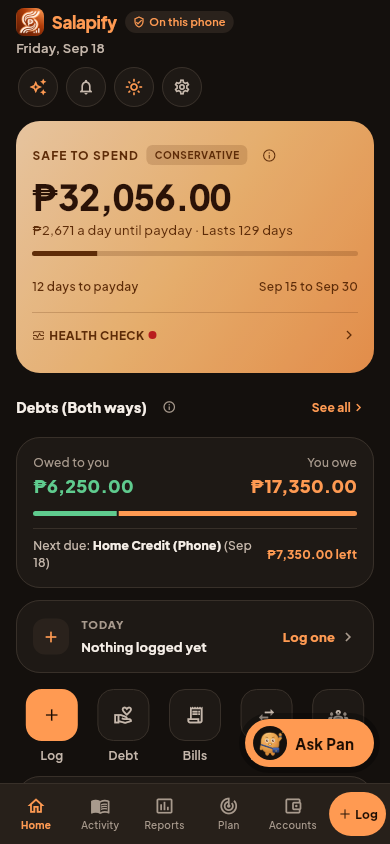 | 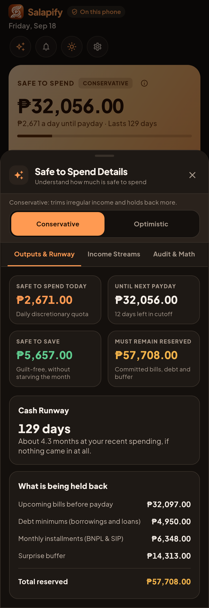 | 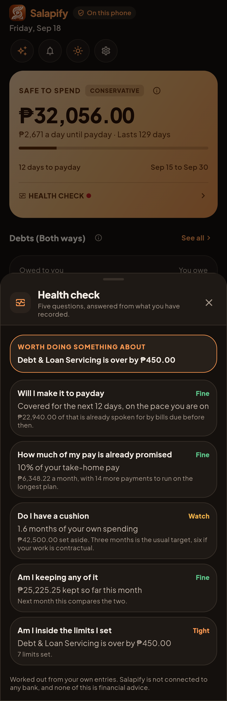 |

How the figures tie:

- Safe to Spend 32,056. It was 24,332 before D32. D32 added the unpaid Spotify on
  the Bills screen (minus 224). D33 let the 8,500 tuition due October 5 wait for the
  next cycle (plus 7,948).
- "Upcoming bills before payday" 32,097 is 29,179 of bills, padded by a tenth
  in the careful scenario.
- The health check's 22,940 "due before payday" is the same bills minus the
  overdue 6,000 remittance and the 239 Spotify whose date reads "Sunday".
  Safe to Spend still holds both back, because both are still owed.

## D32.2, D34, D35: a split counts only your share

| You paid | A friend paid | Activity afterwards |
| --- | --- | --- |
| 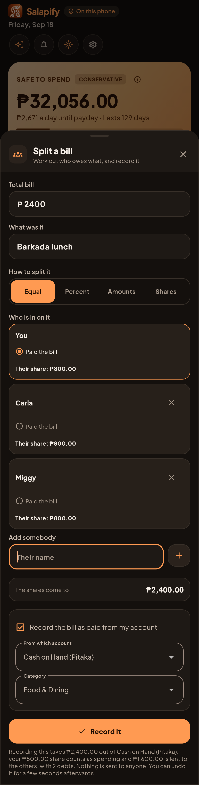 | 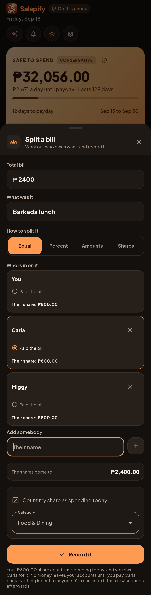 | 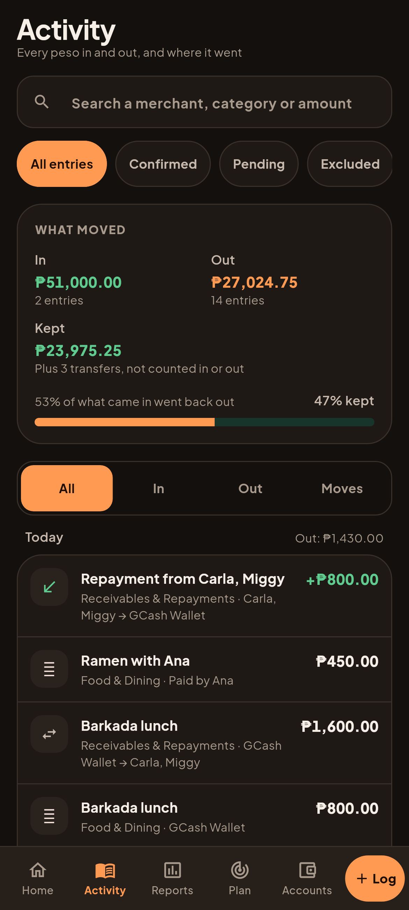 |

- You paid 2,400 for three: 2,400 leaves the account, 800 is your spending,
  1,600 is lent to the others.
- A friend paid: your 800 is spending today, no account moves, and paying the
  friend back later is not spending again.
- In Activity a friend's repayment reads as money in from them, money lent
  reads as leaving for them, and a share a friend paid reads "Paid by Ana".

## D31 + D32.3: lending moves real cash, borrowing mirrors it

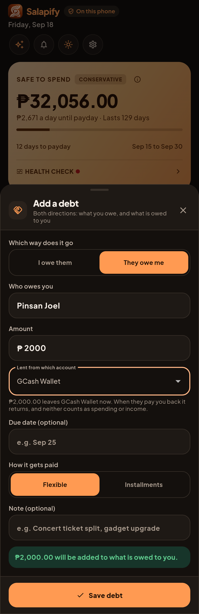

- Add a debt now asks "Lent from which account" (or "Borrowed into which
  account"), with "No money moved now" for older loans, credit cards and
  instalment purchases. It is asked, never defaulted.
- Lent: the money leaves that account now; repayments bring it back. Borrowed:
  it arrives now; repaying moves it out. Neither is spending or income.
- Deleting a debt entered by mistake also reverses the money it moved (only
  a debt with no payments can be deleted, as before).

## D31: repeating bills

| A monthly bill after paying it once | Scheduling one |
| --- | --- |
| 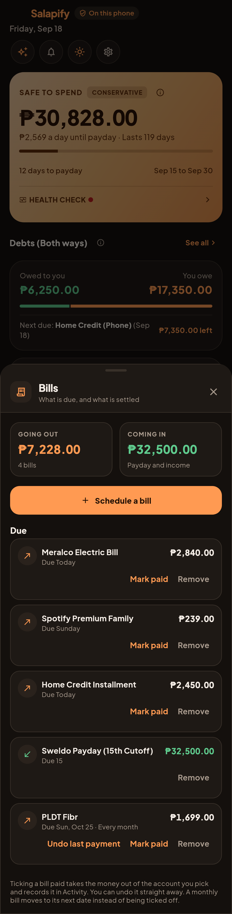 | 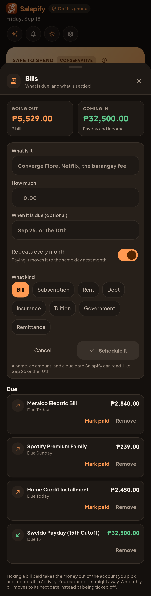 |

- "Repeats every month" on the add form. A monthly bill needs a date Salapify
  can read ("Sep 25", "the 10th").
- Paying it writes the payment and moves the SAME row to next month's date,
  clamped to a short month (the 31st falls on the 30th in September). It is
  never ticked off.
- "Undo last payment" on the row puts the money and the date back. An older
  month's payment can be taken back from Activity on its own.
- The runway chart places it every month it falls in the window.

## D36: borrowing and lending in cash flow; "Going out" by payday

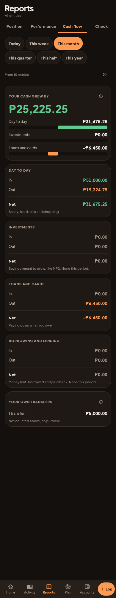

- Reports, Cash flow has a "Borrowing and lending" line: money borrowed and
  collected comes in, money lent and repaid goes out, and it counts toward
  "Your cash grew by". "Your own transfers" now counts only moves between
  your own accounts.
- "Going out" on Bills and Plan adds up only what is due by payday ("3 bills
  due by payday"); every bill is still listed. "Coming in" is unchanged.

## Edit an entry

| The entry, with Edit | Editing it | The old version afterwards |
| --- | --- | --- |
| 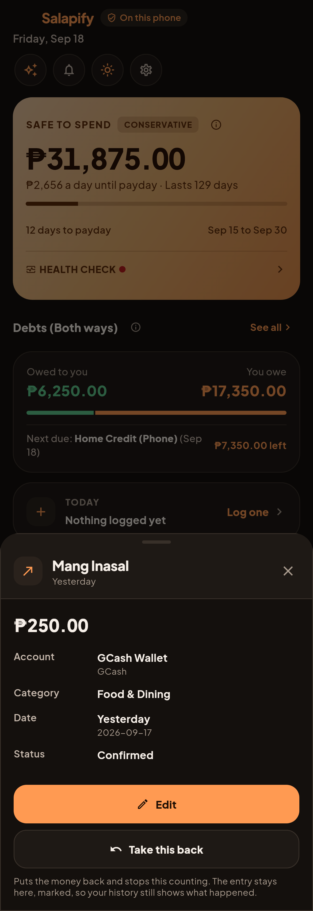 | 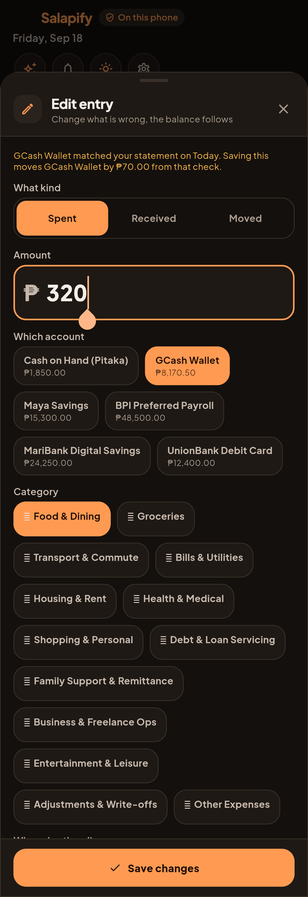 | 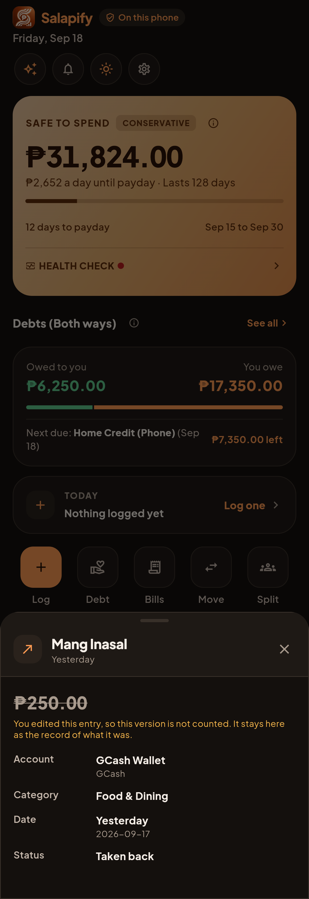 |

- Open any entry in Activity and tap Edit. The Log sheet opens filled in;
  change what is wrong and tap Save changes. The balance follows.
- The old version stays in Activity, struck through and marked Taken back,
  and says "You edited this entry". The corrected one is the one counted.
  Undo on the confirmation puts it back as it was.
- If the account was checked against a statement after the entry was
  logged, the sheet says so at the top before Save, with the amount the
  check will be off by.
- Not editable, with a one line reason: entries tied to a debt, a plan, a
  split, a loan or a reconciliation (same as Take this back), bill
  payments, example entries, money to or from another person, and entries
  on an account an edit cannot offer (a house, money owed to you, a loan
  as the source). Take this back still works on those.
- A Move money entry moved to a different account gets its title rewritten
  to match; a title you wrote yourself is left alone.

## Messages can be closed

| A normal phone | 320dp, the narrowest |
| --- | --- |
| 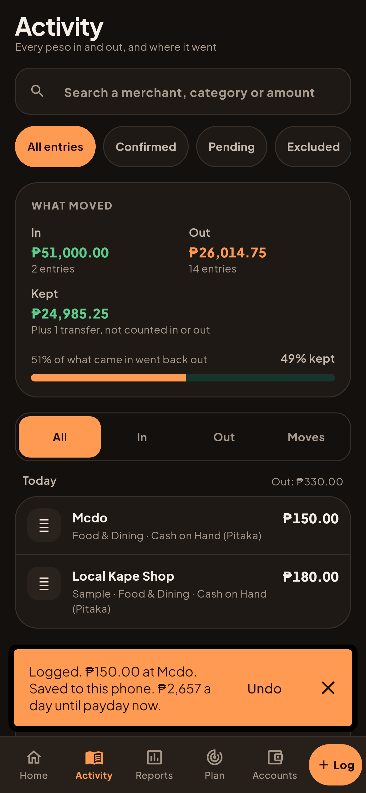 | 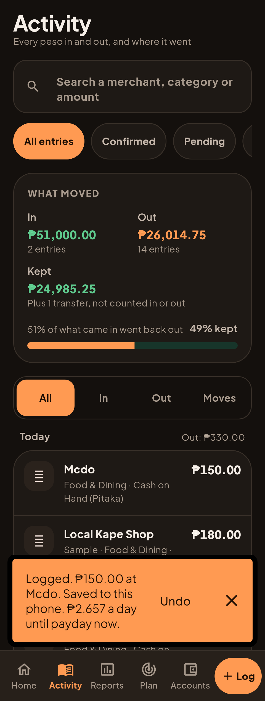 |

- Every message now has a close button (✕), so one already read does not
  sit over the screen for its five seconds. Closing it does not undo
  anything; Undo still does that.
- Messages with an Undo go away on their own again after five seconds
  (Flutter 3.47 had made them stay until tapped).
- The few messages that used Flutter's default dark grey now use the
  same orange as the rest.

## Card payments are editable

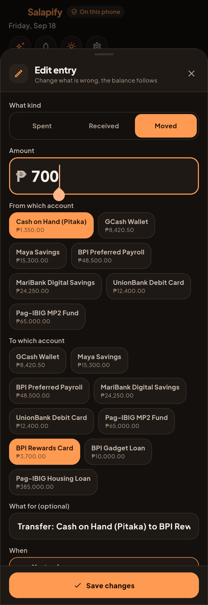

- A payment to a card or a loan (from Move money) and a spend made ON a
  card can now be edited. The form offers the same accounts Move money and
  the receipt scanner do, so the card is selected and Save works.
- Logging a NEW entry is unchanged: everyday accounts only, and paying a
  card is still Move money's job.

## D37: weekly, every two weeks, and no fixed payday

| Every week | Every two weeks | No fixed payday |
| --- | --- | --- |
| 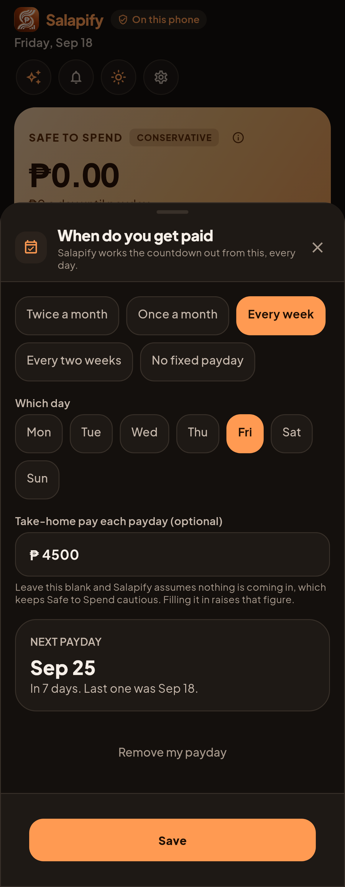 | 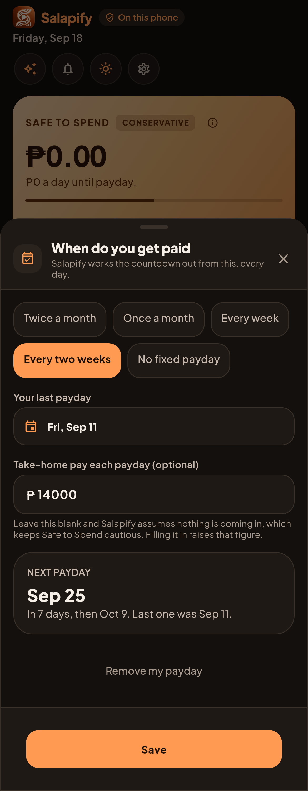 | 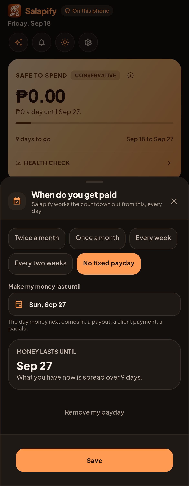 |

| Weekly at 320dp | Home after the "last until" date |
| --- | --- |
| 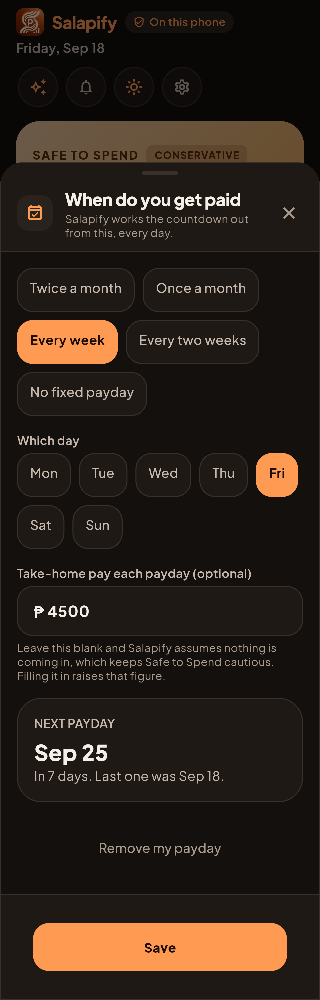 | 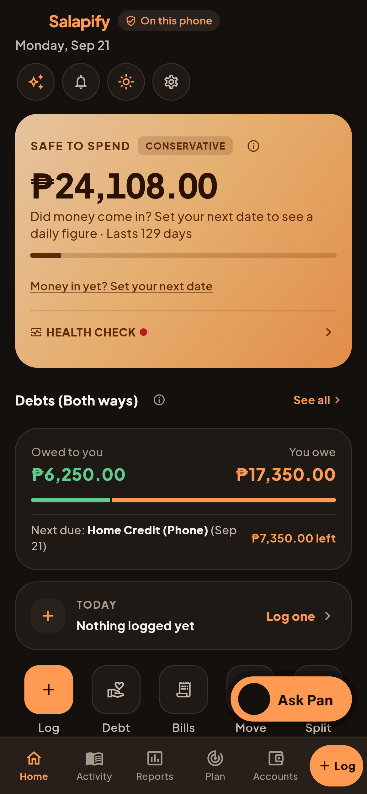 |

- "When do you get paid" now has five choices: Twice a month, Once a month,
  Every week (pick the day), Every two weeks (pick your last payday) and No
  fixed payday (pick the date your money has to last until).
- Every two weeks shows the next payday and the one after, so somebody who
  meant "twice a month" notices.
- No fixed payday asks for no take-home amount, and Home says "N days to
  go" instead of "to payday". When the date comes, the daily figure is
  hidden and Home asks "Did money come in? Set your next date".
- Weekly and every-two-weeks pay hold back bills due in the next 30 days,
  so rent three weeks away is not offered as spending money.
- Fixed on the way: Health Check now counts two paydays a month for a
  twice-a-month payday set in the app (it showed "promised" doubled).

## D38: the three habit features

### Backup reminder

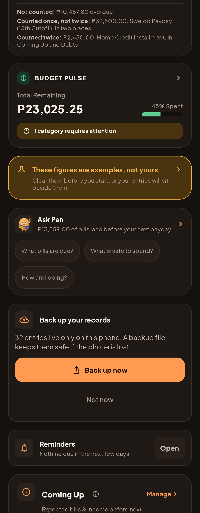

- Home asks only after 30 or more of your own entries AND 14 days since the
  last backup. "Not now" hides it for 14 days. Never a phone buzz.
- Settings' export row now says "Last backup: 3 days ago." or "No backup
  yet." Restoring a backup counts as backed up.

### Money owed to you

| The reminder, with Send a reminder | Its own switch |
| --- | --- |
| 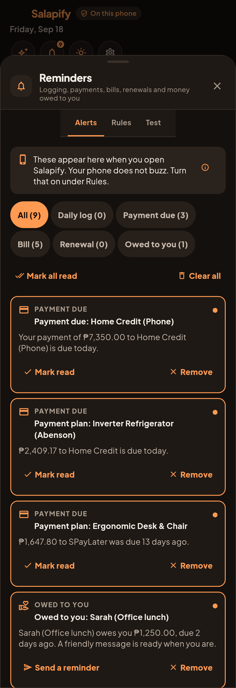 | 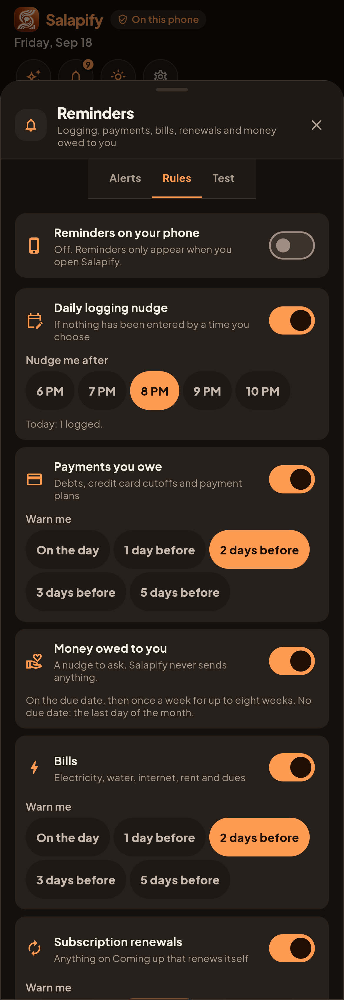 |

- On the due date, then once a week for up to eight weeks. No due date (or
  one Salapify cannot read, like "payday"): the last day of the month.
- "Send a reminder" opens your share sheet with a friendly message.
  Salapify never sends anything itself.

### Park it for 48 hours

| On the Log sheet | Two days later, on Home | On Plan, Goals |
| --- | --- | --- |
| 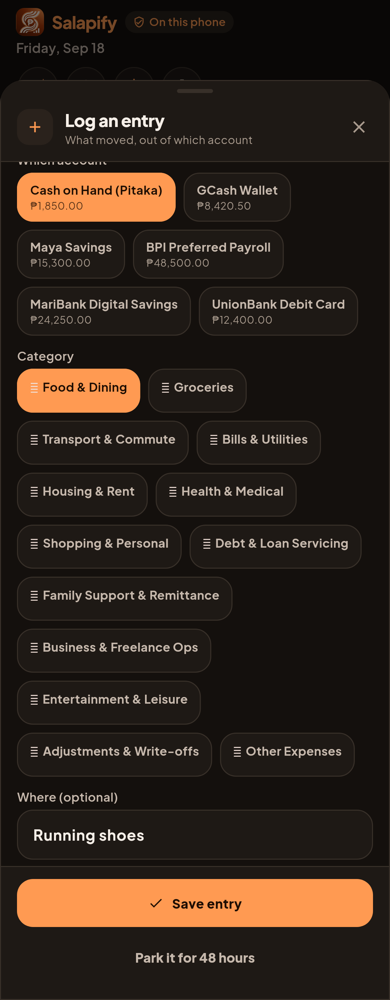 | 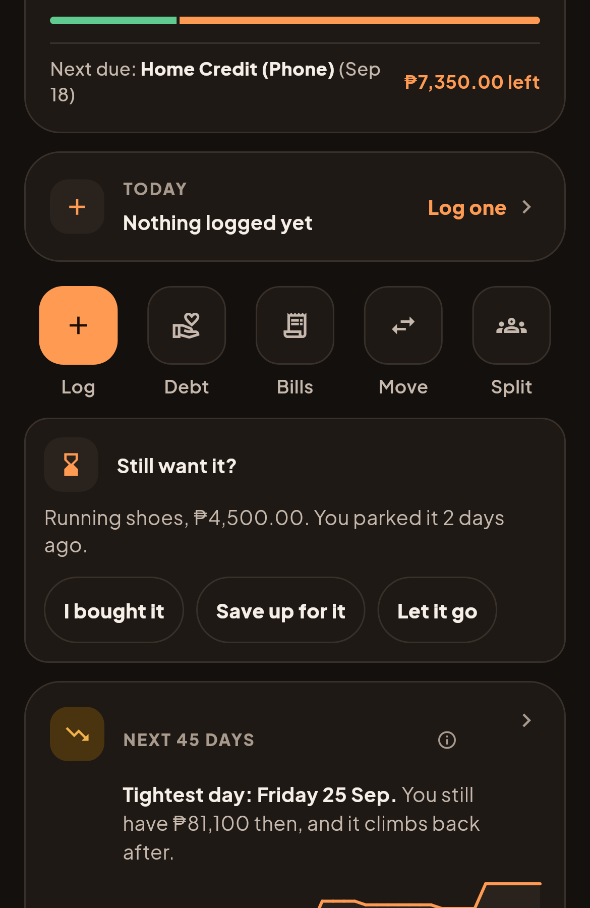 | 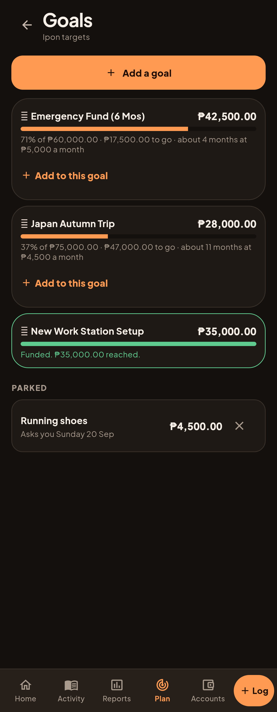 |

- Parking spends nothing. After 48 hours Home asks "Still want it?":
  I bought it (Log opens filled in), Save up for it (a goal, filled in),
  or Let it go (with Undo).

## Reports: earlier periods and category entries

| Stepped back to August | Tap a category |
| --- | --- |
| 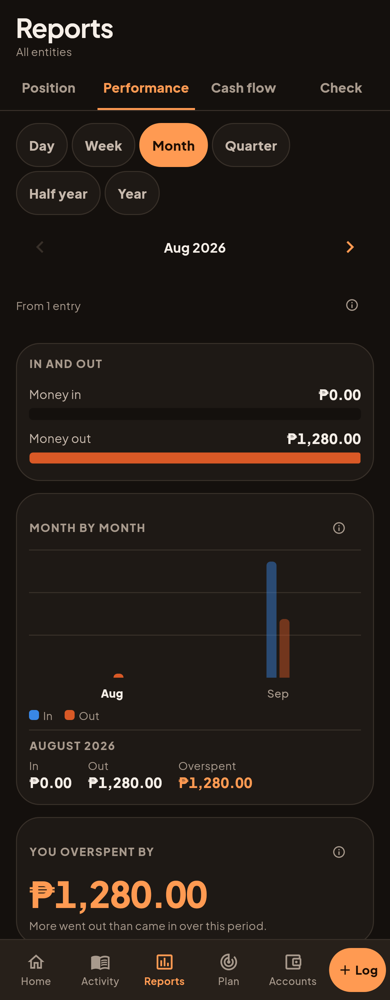 | 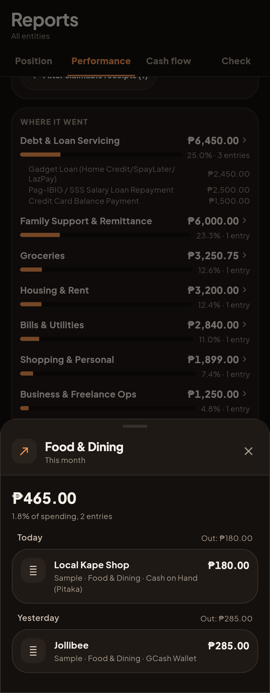 |

- The chips name the unit (Day, Week, Month...) and the arrows step back to
  earlier periods, stopping at your oldest entry.
- Tapping a category lists its entries; the total on the sheet is the same
  figure as the bar, to the centavo.
